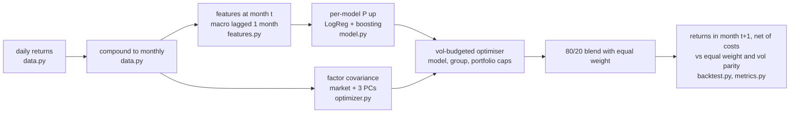

# Vol-Budgeted Model Allocation

[](https://github.com/Avinash186200/vol-budgeted-model-allocation/actions/workflows/ci.yml)  [](LICENSE)

A monthly allocator for a book of systematic trading models. For each model it predicts the probability that next month is positive, then sizes the book with a long-only optimiser under a three-tier volatility budget: per model, per group of models, and for the whole portfolio.

I built this for a book of systematic trading models. The return file is proprietary and is not in this repo. Everything here runs on a **synthetic daily return panel with the same shape** (a `date` column, one column per model, leading zeros before each model goes live), so you can clone it and reproduce every number below.

## What problem this solves

A fund runs many trading models and has to decide each month how much capital each one gets, without breaking its risk limits. The idea tested here is to forecast which models will have a good next month and tilt capital towards them, inside fixed volatility budgets. The honest answer on real data was that the forecast did not beat a simple risk-based split, and this repo shows how to reach that answer cleanly.

## At a glance

| | |
|---|---|
| **Input** | Daily return panel, one column per trading model, staggered inception; optional monthly macro features and a market return series |
| **Method** | Per-model ensemble (logistic regression + gradient boosting) predicts P(next month > 0); factor covariance (market + PCA); SLSQP maximises `w'(P - 0.5)` under per-model, group and portfolio vol caps; 80/20 blend with equal weight |
| **Output** | Monthly weights, net-of-cost returns for the optimiser and for equal-weight and vol-parity baselines, predicted vol, and the rank IC of the forecasts |
| **Leakage controls** | Date-based train/predict split, macro features lagged one month, settings fixed in advance, costs on turnover, a future-perturbation test and a noise test in CI |
| **Status** | Research complete; no demonstrated edge over vol parity on the real book. Numbers below are synthetic only |

## How it works



1. **Monthly returns**: compound the daily returns. Leading zeros are pre-inception and become NaN.
2. **Features** for the row dated month t use returns up to month t: trailing means, vol, Sharpe, win rate, drawdown, and cross-sectional percentile ranks across the book. Macro features are shifted by a one-month publication lag.
3. **Model**: for each live model, fit on rows dated before t (their labels are already realised) and predict the row dated t.
4. **Covariance**: `Σ = B Σ_F B' + D`, with the market as factor 1 and three PCs of the market residuals, over a 36-month window.
5. **Optimiser**: maximise `w'(P - 0.5)` with `w >= 0`, `sum(w) <= 1`, `w_i σ_i <= 1%`, group vol <= 3% and portfolio vol <= 6%. Then `w = 0.8 w_opt + 0.2 w_EW`.
6. **Costs**: 5 bps per unit of one-way turnover, with weights drifted between rebalances.
7. **Compare** with equal weight and vol parity on the same months, and report the rank IC of the forecasts.

A step-by-step code walkthrough with real intermediate output is in [docs/walkthrough.md](docs/walkthrough.md).

## Key concepts

- **Trading model**: one systematic strategy with its own daily return stream. The allocator weights models, not assets.
- **Staggered inception**: models go live at different dates. Zeros before a model's first trade are "not live yet", not flat returns.
- **Walk-forward by date**: at month t, train only on rows whose label month is already over, then predict month t+1.
- **Publication lag**: a macro number for month t is often released later, so it can only be used from month t+1.
- **P(up)**: the predicted probability that a model's next month is positive. The optimiser uses `P - 0.5` as its expected-return signal.
- **Factor covariance**: risk built from a few common factors plus each model's own noise. It is more stable than a raw sample covariance when there are many models and few months.
- **Volatility budget**: a cap on the risk each model, each group and the whole book can take, measured as annualised volatility.
- **Equal weight and vol parity**: two simple baselines. Vol parity gives each model weight in proportion to 1/volatility.
- **Rank IC**: the rank correlation between the forecasts and the returns that followed. Near zero means no forecasting skill.
- **Turnover cost**: a charge in basis points for each unit of weight traded.
- **Sharpe ratio**: annualised return divided by annualised volatility. With 36 months it has a standard error of about 0.5.

## What you will learn

- How to turn a ragged daily return panel into clean monthly data.
- How to do date-based walk-forward selection, and how positional indexing can leak the future.
- How to apply a publication lag to macro features.
- How to write a long-only optimiser with model, group and portfolio vol caps in SciPy.
- Why you should always compare with vol parity, not only equal weight.
- How a noise test shows when a forecast layer is just adding turnover.

## Results on synthetic data

All numbers in this section come from the **synthetic** panel. They show how the method behaves, not what it earns.

`python scripts/run_backtest.py` (24 models, 156 months, last 36 out of sample, 5 bps costs, seed 7):

| Portfolio | Ann. return | Ann. vol | Sharpe | Max DD |
|---|---|---|---|---|
| Optimiser (raw, `opt_raw`) | 9.3% | 3.5% | 2.68 | -1.7% |
| Optimiser (80/20 blend, `opt_blend`) | 8.7% | 3.2% | 2.74 | -1.5% |
| Equal weight | 6.3% | 2.6% | 2.41 | -1.1% |
| Vol parity | 6.1% | 2.5% | 2.40 | -0.9% |

Rank IC of the forecasts: +0.12. The synthetic models have a planted macro effect (`--signal 0.01`). With the signal switched off (`--signal 0`), the same pipeline gives a rank IC of +0.04, and the optimiser **loses** to both baselines (Sharpe 1.42 for the blend against 1.89 for vol parity). That is the honest behaviour: when the forecast is noise, maximising `w'μ` concentrates on noise, and a simple risk-based book wins. The high Sharpe ratios everywhere come from how the synthetic models are generated, not from the method. With 36 monthly observations, the standard error of each Sharpe is roughly 0.5 or more, so the 0.3 gap between the blend and vol parity on the signal run is suggestive, not significant.

> **About the real-data result.** The original research reported the blended optimiser well ahead of equal weight over a 24-month test window. That figure came out of a run with a positional indexing bug, macro features with no publication lag, no costs, and a feature set picked on the same test window (see the audit below). Even in that run, plain vol parity had the best Sharpe of the four. So even the inflated run showed no edge over a simple risk-based book. I don't publish real-data figures here, and I treat the forecast layer as unproven.

## Leakage and bias audit

Details are in [docs/methodology.md](docs/methodology.md).

| Issue | Effect | Fix |
|---|---|---|
| Train/predict rows picked by **position** in a feature frame that had dropped pre-inception rows | For late-starting models, the "row t" was a later month, so the model trained on labels from the future | Rows are selected by date: train on `date < t`, predict `date == t` |
| Macro features dated month t used at month t, described as lagged but not shifted | Look-ahead for any series published after month-end | Macro shifted by `macro_lag=1` month |
| Feature sets, ensemble size and blend rule compared on the same 24-month test window, best one reported | Selection bias on a tiny sample | One configuration, fixed in advance and listed in `Config` |
| Blend weight set by a confidence rule tuned during research | Another tuned knob | Fixed 80/20 blend |
| Market factor built as the **last daily** return of each month, not the monthly return | Wrong covariance factor | Market return compounded to monthly |
| Pre-inception gaps filled with 0 in the covariance window | Understated vol, so larger weights for new models | Gaps filled with the window mean |
| No transaction costs | Optimistic, especially for the optimiser, which turns over more | 5 bps on turnover, with drifted weights |
| Optimiser compared mainly with equal weight | The stronger simple baseline (vol parity) was ignored | Vol parity reported alongside |

## Follow-up: minimum variance, no forecasts

After the forecast layer failed, I tried the opposite: build the book from the covariance alone. The
`volbudget.min_variance` package fits a Ledoit-Wolf shrunk covariance on three daily look-backs (252, 504 and 756
days), solves long-only minimum variance on each, averages the weights and blends them with vol parity. It
rebalances every 5 trading days with a T+2 lag, charges costs on turnover, and is tested on five back-to-back
two-year windows. There is no model fitted to returns anywhere in it. The full write-up, including how it differs
from the optimiser above, is in [docs/min_variance.md](docs/min_variance.md).

What I found, on synthetic data only:

- Uncapped, minimum variance beats vol parity in 5 of 5 windows on the default panel (net Sharpe 3.51 for the
  blend against 2.27), because the synthetic models share hidden factors that it can hedge out.
- It does that by putting up to seven times the per-model risk limit on a few models. With the same vol budget
  enforced on both, the capped blend (2.30) is no better than capped vol parity (2.32).
- On a control panel of independent models with equal Sharpe ratios, it adds turnover and nothing else.

Auditing my original code for this follow-up, I found no look-ahead in the weights, but the blend weight was picked
on the same five windows it was then scored on, the two legs of the blend were on different scales, and the blend
breached the per-model and group caps. The maintained version chooses the blend weight on the two oldest windows
only, scales both legs to the same vol, and projects the final weights onto every cap. I don't publish the
real-data figures.

```bash
python scripts/run_min_variance.py                 # synthetic panel, five windows, about 30 s
python scripts/run_min_variance.py --independent   # control: nothing for min-variance to find
python scripts/run_min_variance.py --sweep         # ruled-out constructions and overlays (slow)
```

## Follow-up 2: a conditional allocation selector (1.4.0)

**Scenario.** An allocator has five ways to build the book (equal weight, vol parity, minimum variance, equal risk
contribution and the vol-budgeted optimiser above) and suspects the best one depends on the regime. They want to know
whether an ML selector that picks the method each month beats always using one method, after costs. (A scenario on
synthetic data, not a record of real work.)

The `volbudget.selector` package computes point-in-time regime features at each month-end (trailing vol, average
correlation, first-PC share, dispersion, trend and each method's recent relative Sharpe), labels each month with the
method that had the best risk-adjusted return over the next month, and trains a multinomial logistic regression and
a random forest. The **hard** selector holds the most probable method's book; the **soft** one blends the five books
by predicted probability. Training rows are purged and embargoed (`s + h + 1 <= t`), models are refit on an
expanding window, all 24 configurations are scored on a development period only, and the last 60 months are run
once. It also adds a **long-short optimiser** in cvxpy (`w = w_long - w_short`, 2% a year borrow on shorts, gross
1.5 and net 0 to 1 limits, a turnover penalty and the same vol budget), compared with the same problem long-only.

The synthetic generator gains a regime mode: a hidden calm/stress state that changes which method wins (planted,
at two strengths), and the unchanged generator as the control. The main result is from ten seeds (101 to 110) that
were not used while building anything (`results/selector/multiseed.json`, `modes.<mode>.summary.selectors`).
Selector held-out net Sharpe minus the **best fixed method chosen on the development period**; "significant" means
a paired block-bootstrap P(diff <= 0) below a Bonferroni threshold, 0.0125 for four selectors per panel or 0.0042
for all 12 selector-panel tests, with 21-day blocks:

| Panel | Median diff (four selectors) | Seeds ahead | Significant (4 tests) | Significant (12 tests) |
|---|---|---|---|---|
| Planted, strong (s = 2) | +1.36 to +1.49 | 10 / 10 for every selector | 6 to 8 / 10 | 4 to 6 / 10 |
| Planted, weaker (s = 1) | +0.28 to +0.47 | 8 to 10 / 10 | 1 / 10 | 0 to 1 / 10 |
| Control (no regime effect) | -0.11 to -0.02 | 0 to 3 / 10 | 0 / 10 | 0 / 10 |

What I found:

- **When the regime effect is strong, the selector beats every fixed method on every untouched seed**, including the
  method that turned out best on the held-out period itself, and the gap is significant on about half to most
  seeds, depending on the correction and block length. **When the effect is weaker, it is usually ahead but by
  little, and almost never significantly. With no effect, it adds nothing** (the small shortfall is mostly extra
  turnover), which is also the check against leakage.
- Neither the hard (argmax) nor the soft (probability-blend) selector is reliably better: soft won 50 to 60% of
  same-seed pairs (`share_soft_beats_hard`).
- `regime_rule`, a reference that is a hard switch told the current true state, was beaten by the selectors on 4 or
  5 of 10 strong-panel seeds; it is not a ceiling.
- The best fixed method changed from seed to seed on the strong panel, so no single fixed method was a safe default.
- The long-short book lost to the same problem solved long-only on 29 of 30 seed-mode runs; its trailing-mean signal
  is late at regime turns and the short side pays borrow.
- **Seed 7, the seed I used while designing the planted factor, is disclosed separately**: it is the least favourable
  case. At s = 2 the hard selectors lost to ERC (-0.68 and -0.36) and the soft ones were +0.17 and +0.19, none
  significant; at s = 1 three of four trailed the dev-chosen minimum variance. Held-out results on seed 7 were
  printed while I tuned the generator, seeds 8 and 9 were used for generator checks and seeds 5, 11 and 23 in an
  earlier review (none is in 101 to 110), and the `top_pc_share` feature was added with the generator's design in
  mind.
- **Limitations.** The planted generator was designed so that the best method switches with a persistent,
  observable state, that is, so that a regime selector can win; the s = 2 result shows the pipeline can find an
  effect built for it, not that one exists in real markets. The synthetic Sharpe levels are inflated; read the
  differences. Results are bit-reproducible single-threaded (the scripts pin BLAS to one thread); a different thread
  count or library version can move individual differences by about 0.3.

The full method, timeline, turnover and cost tables, the multiple-testing note and the limitations are in
[docs/selector.md](docs/selector.md).

```bash
python scripts/run_selector.py                  # seed 7, planted regime effect, strength 2 (about 1.5 min)
python scripts/run_selector.py --strength 1     # seed 7, weaker planted effect
python scripts/run_selector.py --mode control   # seed 7, no regime effect
python scripts/run_selector_sweep.py            # seeds 101-110, all three panels (about 45 min, not in CI)
```

## Repo layout

```
src/volbudget/   data.py · features.py · model.py · optimizer.py · backtest.py · metrics.py
  min_variance/  covariance.py · weights.py · backtest.py · evaluation.py · sweep.py (the non-ML follow-up)
  selector/      methods.py · features.py · walkforward.py · longshort.py · evaluation.py (regime selector)
scripts/         run_backtest.py · run_min_variance.py · run_selector.py · run_selector_sweep.py ·
                 make_synthetic_data.py (writes data/*.csv)
tests/           test_pipeline.py: compounding, feature timing, macro lag, future-perturbation, budget, noise test
                 test_min_variance.py: look-ahead, T+2 lag, caps, costs, bootstrap, hold-out choice, control panel
                 test_selector.py: point-in-time features and targets, purge/embargo, held-out isolation, books
                 test_longshort.py: limits, long/short split, borrow, turnover penalty (skipped without cvxpy)
results/selector/ multiseed.json (10 seeds) and per-run results.json behind every selector number
docs/            README.md (index) · methodology.md · walkthrough.md · min_variance.md · selector.md
original/        the original research code (read-only); min_variance/ holds the follow-up
```

## Quick start

```bash
pip install -e ".[dev,longshort]"   # runtime + pytest (dev) + cvxpy (longshort)
python -m pytest -q
python scripts/run_backtest.py                  # synthetic, with planted signal
python scripts/run_backtest.py --signal 0       # synthetic, pure noise
python scripts/make_synthetic_data.py           # writes data/returns.csv, data/macro.csv, data/market.csv
python scripts/run_backtest.py --daily data/returns.csv --macro data/macro.csv --market data/market.csv
```

The last command shows how to run your own data: a daily return CSV with a `date` column and one column per model,
and optional monthly macro and market CSVs. Each backtest takes a few minutes, because every month refits a model
for every live trading model.

## Original research code

[`original/`](original/README.md) holds the code as I first wrote it for this project. It is kept so you can
read the first version alongside the maintained one; some of it contains the issues in the audit table above,
and comparing the two shows each fix.

## License

MIT

See [CONTRIBUTING.md](CONTRIBUTING.md) and the [CHANGELOG](CHANGELOG.md).
