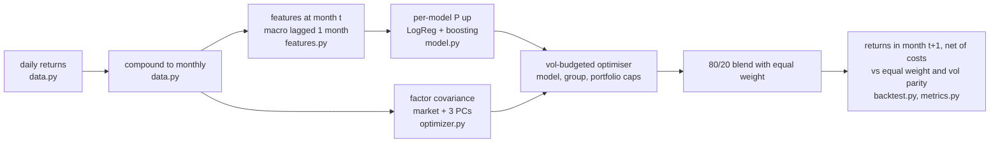

# Vol-Budgeted Model Allocation

[](https://github.com/Avinash186200/vol-budgeted-model-allocation/actions/workflows/ci.yml)  [](LICENSE)

A monthly allocator for a book of systematic trading models. For each model it predicts the probability that next month is positive, then sizes the book with a long-only optimiser under a three-tier volatility budget: per model, per group of models, and for the whole portfolio.

I built this for a book of systematic trading models. The return file is proprietary and is not in this repo. Everything here runs on a **synthetic daily return panel with the same shape** (a `date` column, one column per model, leading zeros before each model goes live), so you can clone it and reproduce every number below.

## What problem this solves

A fund runs many trading models and has to decide each month how much capital each one gets, without breaking its risk limits. The idea tested here is to forecast which models will have a good next month and tilt capital towards them, inside fixed volatility budgets. The honest answer on real data was that the forecast did not beat a simple risk-based split, and this repo shows how to reach that answer cleanly.

## At a glance

| | |
|---|---|
| **Input** | Daily return panel, one column per trading model, staggered inception; optional monthly macro features and a market return series |
| **Method** | Per-model ensemble (logistic regression + gradient boosting) predicts P(next month > 0); factor covariance (market + PCA); SLSQP maximises `w'(P - 0.5)` under per-model, group and portfolio vol caps; 80/20 blend with equal weight |
| **Output** | Monthly weights, net-of-cost returns for the optimiser and for equal-weight and vol-parity baselines, predicted vol, and the rank IC of the forecasts |
| **Leakage controls** | Date-based train/predict split, macro features lagged one month, settings fixed in advance, costs on turnover, a future-perturbation test and a noise test in CI |
| **Status** | Research complete; no demonstrated edge over vol parity on the real book. Numbers below are synthetic only |

## How it works



1. **Monthly returns**: compound the daily returns. Leading zeros are pre-inception and become NaN.
2. **Features** for the row dated month t use returns up to month t: trailing means, vol, Sharpe, win rate, drawdown, and cross-sectional percentile ranks across the book. Macro features are shifted by a one-month publication lag.
3. **Model**: for each live model, fit on rows dated before t (their labels are already realised) and predict the row dated t.
4. **Covariance**: `Σ = B Σ_F B' + D`, with the market as factor 1 and three PCs of the market residuals, over a 36-month window.
5. **Optimiser**: maximise `w'(P - 0.5)` with `w >= 0`, `sum(w) <= 1`, `w_i σ_i <= 1%`, group vol <= 3% and portfolio vol <= 6%. Then `w = 0.8 w_opt + 0.2 w_EW`.
6. **Costs**: 5 bps per unit of one-way turnover, with weights drifted between rebalances.
7. **Compare** with equal weight and vol parity on the same months, and report the rank IC of the forecasts.

A step-by-step code walkthrough with real intermediate output is in [docs/walkthrough.md](docs/walkthrough.md).

## Key concepts

- **Trading model**: one systematic strategy with its own daily return stream. The allocator weights models, not assets.
- **Staggered inception**: models go live at different dates. Zeros before a model's first trade are "not live yet", not flat returns.
- **Walk-forward by date**: at month t, train only on rows whose label month is already over, then predict month t+1.
- **Publication lag**: a macro number for month t is often released later, so it can only be used from month t+1.
- **P(up)**: the predicted probability that a model's next month is positive. The optimiser uses `P - 0.5` as its expected-return signal.
- **Factor covariance**: risk built from a few common factors plus each model's own noise. It is more stable than a raw sample covariance when there are many models and few months.
- **Volatility budget**: a cap on the risk each model, each group and the whole book can take, measured as annualised volatility.
- **Equal weight and vol parity**: two simple baselines. Vol parity gives each model weight in proportion to 1/volatility.
- **Rank IC**: the rank correlation between the forecasts and the returns that followed. Near zero means no forecasting skill.
- **Turnover cost**: a charge in basis points for each unit of weight traded.
- **Sharpe ratio**: annualised return divided by annualised volatility. With 36 months it has a standard error of about 0.5.

## What you will learn

- How to turn a ragged daily return panel into clean monthly data.
- How to do date-based walk-forward selection, and how positional indexing can leak the future.
- How to apply a publication lag to macro features.
- How to write a long-only optimiser with model, group and portfolio vol caps in SciPy.
- Why you should always compare with vol parity, not only equal weight.
- How a noise test shows when a forecast layer is just adding turnover.

## Results on synthetic data

All numbers in this section come from the **synthetic** panel. They show how the method behaves, not what it earns.

`python scripts/run_backtest.py` (24 models, 156 months, last 36 out of sample, 5 bps costs, seed 7):

| Portfolio | Ann. return | Ann. vol | Sharpe | Max DD |
|---|---|---|---|---|
| Optimiser (raw, `opt_raw`) | 9.3% | 3.5% | 2.68 | -1.7% |
| Optimiser (80/20 blend, `opt_blend`) | 8.7% | 3.2% | 2.74 | -1.5% |
| Equal weight | 6.3% | 2.6% | 2.41 | -1.1% |
| Vol parity | 6.1% | 2.5% | 2.40 | -0.9% |

Rank IC of the forecasts: +0.12. The synthetic models have a planted macro effect (`--signal 0.01`). With the signal switched off (`--signal 0`), the same pipeline gives a rank IC of +0.04, and the optimiser **loses** to both baselines (Sharpe 1.42 for the blend against 1.89 for vol parity). That is the honest behaviour: when the forecast is noise, maximising `w'μ` concentrates on noise, and a simple risk-based book wins. The high Sharpe ratios everywhere come from how the synthetic models are generated, not from the method. With 36 monthly observations, the standard error of each Sharpe is roughly 0.5 or more, so the 0.3 gap between the blend and vol parity on the signal run is suggestive, not significant.

> **About the real-data result.** The original research reported the blended optimiser well ahead of equal weight over a 24-month test window. That figure came out of a run with a positional indexing bug, macro features with no publication lag, no costs, and a feature set picked on the same test window (see the audit below). Even in that run, plain vol parity had the best Sharpe of the four. So even the inflated run showed no edge over a simple risk-based book. I don't publish real-data figures here, and I treat the forecast layer as unproven.

## Leakage and bias audit

Details are in [docs/methodology.md](docs/methodology.md).

| Issue | Effect | Fix |
|---|---|---|
| Train/predict rows picked by **position** in a feature frame that had dropped pre-inception rows | For late-starting models, the "row t" was a later month, so the model trained on labels from the future | Rows are selected by date: train on `date < t`, predict `date == t` |
| Macro features dated month t used at month t, described as lagged but not shifted | Look-ahead for any series published after month-end | Macro shifted by `macro_lag=1` month |
| Feature sets, ensemble size and blend rule compared on the same 24-month test window, best one reported | Selection bias on a tiny sample | One configuration, fixed in advance and listed in `Config` |
| Blend weight set by a confidence rule tuned during research | Another tuned knob | Fixed 80/20 blend |
| Market factor built as the **last daily** return of each month, not the monthly return | Wrong covariance factor | Market return compounded to monthly |
| Pre-inception gaps filled with 0 in the covariance window | Understated vol, so larger weights for new models | Gaps filled with the window mean |
| No transaction costs | Optimistic, especially for the optimiser, which turns over more | 5 bps on turnover, with drifted weights |
| Optimiser compared mainly with equal weight | The stronger simple baseline (vol parity) was ignored | Vol parity reported alongside |

## Repo layout

```
src/volbudget/   data.py · features.py · model.py · optimizer.py · backtest.py · metrics.py
scripts/         run_backtest.py · make_synthetic_data.py (writes data/returns.csv, macro.csv, market.csv)
tests/           compounding, feature timing, macro lag, future-perturbation, budget, noise test
docs/            README.md (index) · methodology.md · walkthrough.md
original/        the original research code, sanitised (read-only)
```

## Quick start

```bash
pip install -r requirements.txt
python -m pytest -q
python scripts/run_backtest.py                  # synthetic, with planted signal
python scripts/run_backtest.py --signal 0       # synthetic, pure noise
python scripts/make_synthetic_data.py           # writes data/returns.csv, data/macro.csv, data/market.csv
python scripts/run_backtest.py --daily data/returns.csv --macro data/macro.csv --market data/market.csv
```

The last command shows how to run your own data: a daily return CSV with a `date` column and one column per model,
and optional monthly macro and market CSVs. Each backtest takes a few minutes, because every month refits a model
for every live trading model.

## Original research code

[`original/`](original/README.md) holds the code as I first wrote it for this work, sanitised and nothing else:
client, company and person names replaced, credentials and local paths removed, data files and notebook outputs
dropped, and internal deployment notes, client-facing decks and client findings memos left out. It is kept so
the real work can be read alongside the maintained version. Some of it contains the issues
described above; comparing the two shows each fix.

## License

MIT

See [CONTRIBUTING.md](CONTRIBUTING.md) and the [CHANGELOG](CHANGELOG.md).
