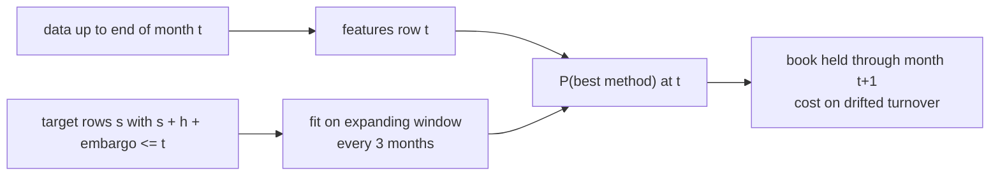

# Conditional allocation selector: picking the method by regime

The main package and the minimum-variance follow-up each fix one way of building the book. This page asks a
different question: if the best construction method changes with the market regime, can a model that picks the
method each month beat simply always using one method, after costs? It also adds a long-short optimiser with a
borrow cost, written as one convex problem, to compare with the long-only methods.

Code: [`src/volbudget/selector/`](../src/volbudget/selector/). Script:
[`scripts/run_selector.py`](../scripts/run_selector.py). Tests:
[`tests/test_selector.py`](../tests/test_selector.py), [`tests/test_longshort.py`](../tests/test_longshort.py).
Results: [`results/selector/`](../results/selector/).

## Scenario

An allocator runs a book of systematic trading models and has five ways to size it: equal weight, vol parity,
minimum variance, equal risk contribution (ERC) and the vol-budgeted optimiser from the main package. Looking back,
each method had good years and bad years, and the allocator suspects the winner depends on the regime: calm,
trending markets reward books that lean into the common factor, and stressed, correlated markets reward books that
hedge it. They want to know whether an ML selector that chooses the method each month, from what the market looks
like at month-end, beats always using one method once trading costs are paid. This is a scenario on synthetic data,
not a record of real work.

## The candidates

At each month-end `m`, from daily returns up to and including the last day of `m`:

| Method | Book |
|---|---|
| `equal_weight` | 1/N across active models, scaled to 6% predicted vol |
| `vol_parity` | `w_i ∝ 1/σ_i`, scaled to 6% |
| `min_variance` | long-only minimum variance, scaled to 6% |
| `erc` | equal risk contribution, scaled to 6% |
| `vb_optimiser` | `volbudget.optimizer.optimize`: maximise `w'μ` under the per-model (1%), group (3%) and portfolio (6%) vol caps, long-only, `sum(w) <= 1` |

The covariance is Ledoit-Wolf on the last 252 days of the models with no gap in that window. `μ` for the optimiser
is each model's trailing 252-day mean return. The main package fed this optimiser with a per-model ML forecast; that
would mean refitting one model per trading model per month inside this loop, so it is replaced here by the trailing
mean. Each book is bought at month-end and held through the next month without trading, so its weights drift; the
next rebalance trades from the drifted weights and pays 5 bp per unit of one-way turnover.

## Features and target

Feature row `m` (all from data up to the end of month `m`):

- `vol_s`, `vol_m`: annualised vol of the equal-weight book over 21 and 63 days; `vol_ratio`: 21-day over 126-day vol;
- `avg_corr`: average pairwise correlation over 63 days; `top_pc_share`: share of variance on the first principal
  component over 63 days (it does not cancel when some models load negatively on a factor);
- `dispersion`: cross-sectional std of 63-day model returns; `trend`: 126-day equal-weight return over its vol;
- `rel_<method>`: each method's trailing 63-day net Sharpe minus the average of the five (recent method momentum).

Target row `m`: the method with the best risk-adjusted net return (mean over std of daily returns) over months
`m+1 .. m+h`. `h = 1` by default; the code handles any `h`.

## Models and books

- Multinomial logistic regression (standardised features, L2, `C` in {0.03, 0.3, 3}).
- Random forest (150 trees, `min_samples_leaf` in {3, 10, 25}).
- **Hard** selector: hold the book of the most probable method.
- **Soft** selector: hold `Σ_k q_k w_k`, with `q ∝ p^(1/T)` and temperature `T` in {0.5, 1, 2}. Lower `T` is closer
  to hard; higher `T` is closer to an equal blend.
- Baselines: each fixed method; `equal_blend` (the average of the five books, no model); `oracle` (the method that
  did turn out best next month, which uses the future and is only an upper bound); and on the planted panel
  `regime_rule`, a reference: a hard switch told the current true state, which uses whichever method did best in
  that state over the development period. It is not a ceiling (a model can beat it by using more than the state,
  or by blending), and it is not tradable.

## Timeline and leakage controls



- **Point in time**: the feature row and every method book at `m` use data up to the last day of `m`. Tests change
  every return after a month-end and check that nothing dated at or before it moves.
- **Purge and embargo**: at decision month `t`, a training row `s` is used only if `s + h + embargo <= t` (its
  target is realised, plus one more month by default). A test scrambles every target that is not yet realised and
  checks that the prediction does not change.
- **Expanding window**: models are refit on all usable rows every 3 months.
- **Development and held-out periods**: the decision months are split once, in time order. The last 60 are held
  out. All 24 configurations (2 models x 3 settings x {hard, soft at 3 temperatures}) are scored on the development
  months only, the best hard and best soft configuration of each model are frozen, and the held-out months are run
  once with those choices. The best fixed method is also chosen on the development months. A test changes every
  return in the held-out period and checks that the development step gives the same table and the same choices.
- Every strategy starts the held-out period from cash, so each pays its own initial buy-in under the same rule.

## Synthetic data: planted and control

`make_synthetic(..., regime_strength=s)` adds a hidden monthly calm/stress state (a two-state Markov chain; stress is
about 45% of months on seed 7) and a common factor that every model loads on, most of them positively. In calm months
the factor drifts up with low vol; in stress months its vol is 2.5 times higher and its drift is negative. Books
with net exposure to the factor do well in calm months; minimum variance hedges it and does well in stress. The
control is the same generator with `regime_strength=0`: no hidden state and no regime effect, and every number
from the 1.0-1.3 releases is unchanged.

Two planted strengths are reported: `s = 2` (the default, a strong effect) and `s = 1` (a weaker one). The Sharpe
ratios on this panel are high because of how the synthetic models are generated; read the differences, not the
levels. The dates on the panel are synthetic calendar labels, not real market dates.

## Results across 10 untouched seeds (the main result)

Seed 7 was the seed I used while designing the planted factor (see "Multiple testing and disclosures"), so the
main result comes from ten other seeds, 101 to 110. Seeds 8 and 9 were also used for checks while I designed the
generator, and seeds 5, 11 and 23 were used in an earlier external review of this work; none of them is in 101 to
110, and 101 to 110 were run only with the frozen code. Command: `python scripts/run_selector_sweep.py` (30 full
studies, single-threaded BLAS, about 45 minutes on one core; not run in CI). Every run is stamped with a
`code_hash` of the package and scripts, and the sweep refuses to summarise runs from different code. The compact
per-seed records and the summaries are in `results/selector/multiseed.json`, and a test recomputes every summary
from the records. Each number below is a field of `modes.<mode>.summary`.

"Diff" is the selector's held-out net Sharpe minus that of the **best fixed method chosen on the development
period** (a choice an allocator could have made at the time). "Signif." counts seeds where the paired block
bootstrap gives P(diff <= 0) (the share of percentile-bootstrap draws at or below zero) below a Bonferroni threshold:
0.05 / 4 = 0.0125 for the four selectors within one panel (`share_significant`), or 0.05 / 12 = 0.0042 for all
four selectors on all three panels (`share_significant_12`); each with 21-day / 63-day mean blocks.

| Mode | Selector | Median diff | Range | Seeds ahead (of 10) | Signif., 4 tests (21d / 63d) | Signif., 12 tests (21d / 63d) | Ahead of hindsight best | Ahead of `regime_rule` |
|---|---|---|---|---|---|---|---|---|
| Planted, s = 2 | `logit_hard` | +1.36 | +0.78 to +2.34 | 10 | 6 / 6 | 5 / 4 | 10 | 4 |
|  | `logit_soft` | +1.40 | +0.63 to +2.35 | 10 | 8 / 7 | 6 / 5 | 10 | 5 |
|  | `forest_hard` | +1.38 | +0.27 to +2.26 | 10 | 6 / 5 | 4 / 3 | 10 | 4 |
|  | `forest_soft` | +1.49 | +0.44 to +2.37 | 10 | 6 / 5 | 5 / 5 | 10 | 4 |
| Planted, s = 1 | `logit_hard` | +0.28 | -0.58 to +1.07 | 8 | 1 / 1 | 0 / 0 | 8 | 2 |
|  | `logit_soft` | +0.40 | +0.07 to +1.25 | 10 | 1 / 1 | 1 / 1 | 10 | 3 |
|  | `forest_hard` | +0.47 | -0.03 to +0.99 | 9 | 1 / 1 | 1 / 1 | 9 | 2 |
|  | `forest_soft` | +0.36 | +0.07 to +1.35 | 10 | 1 / 1 | 1 / 1 | 10 | 3 |
| Control | `logit_hard` | -0.05 | -0.41 to +0.02 | 1 | 0 / 0 | 0 / 0 | 0 | n/a |
|  | `logit_soft` | -0.11 | -0.25 to +0.09 | 3 | 0 / 0 | 0 / 0 | 2 | n/a |
|  | `forest_hard` | -0.02 | -0.55 to +0.00 | 0 | 0 / 0 | 0 / 0 | 0 | n/a |
|  | `forest_soft` | -0.09 | -0.28 to +0.08 | 2 | 0 / 0 | 0 / 0 | 1 | n/a |

Other summary fields:

- Median held-out net Sharpe of the dev-chosen best fixed method (`median_dev_best_net_sharpe`): 5.57 at s = 2,
  3.55 at s = 1, 3.16 on the control. Median for the selectors at s = 2 (`median_net_sharpe`): 6.12 to 6.76.
- Which fixed method the development period picked (`dev_best_counts`): at s = 2 it varies by seed
  (`vb_optimiser` 5, `erc` 2, one each for `equal_weight`, `min_variance` and `vol_parity`); at s = 1, `erc` 8 of 10;
  on the control, `min_variance` 7 and `erc` 3.
- Soft against hard, same model and seed (`share_soft_beats_hard`): soft was ahead in 60% of pairs at s = 2, 50% at
  s = 1 and 55% on the control. There is no consistent winner.
- Long-short against the same problem long-only (`share_long_short_beats_long_only`): ahead on 1 of 10 seeds at
  s = 2 and on none at s = 1 or on the control.

## What the results say

- **With a strong regime effect, the selector beats every fixed method on every untouched seed.** At s = 2 all four
  selectors were ahead of the dev-chosen best fixed method on 10 of 10 seeds (median +1.36 to +1.49 Sharpe), and also
  ahead of the fixed method that turned out best on the held-out period itself. The gap is significant on about
  half to most seeds, depending on the correction and the block length: 5 to 8 of 10 with the per-panel threshold,
  3 to 6 of 10 with the 12-test threshold.
- **With a weaker effect, the gain is small and mostly not significant.** At s = 1 the selectors were ahead on 8 to
  10 of the 10 seeds, but by a median of only +0.28 to +0.47, and the gap was significant on at most 1 seed of 10.
- **With no regime effect, the selector adds nothing.** On the control no selector was significantly ahead on any
  seed; the median gap was -0.02 to -0.11, mostly extra turnover. That is also the evidence against leakage:
  the same pipeline finds nothing when nothing is there.
- **Neither soft nor hard is reliably better.** Across seeds soft won about half the pairs. Hard switching trades
  more (at seed 7, s = 2: 6.5 to 7.6 a year against 2.6 for ERC), but on several seeds the extra trading paid off.
- **`regime_rule` is a reference, not a ceiling.** It is a hard switch told the current true state; the selectors
  beat it on 4 or 5 of 10 seeds at s = 2, because they also use the recent performance of each method and can blend.
  The oracle, which knows next month's winner, is far above both and is not attainable.
- **No single fixed method is a safe default.** The dev-chosen best fixed method changed from seed to seed on the
  strong panel; ERC was the usual choice only on the weaker panel.
- **The long-short book almost always lost to its long-only twin** (ahead on 1 of 30 seed-mode runs). Its signal is
  the trailing mean, which is late at every regime turn, and the short side pays 2% a year of borrow plus extra
  turnover.

## The tuning seed (seed 7), disclosed

Seed 7 is shown in full because it is the seed the generator was designed on. It turned out to be the least
favourable case for the selector. At s = 2 the hard selectors **lost** to ERC (-0.68 and -0.36) and the soft ones
were only +0.17 and +0.19 ahead, none of them significant, against medians of +1.36 to +1.49 on the untouched seeds.
At s = 1 three of the four selectors trailed the dev-chosen `min_variance` (-0.58, -0.12, -0.14; `forest_soft`
+0.04). Commands: `python scripts/run_selector.py`,
`python scripts/run_selector.py --strength 1`, `python scripts/run_selector.py --mode control`. 24 models, 240
months, 5 bp costs, 2,000 bootstrap draws, 110 development and 60 held-out decision months. Each number is a field of
`results/selector/<run>/results.json`: Sharpe values are `holdout.stats.<strategy>.net_sharpe`, turnover is
`turnover_yr`, cost drag is `cost_drag_bp`, differences are `holdout.bootstrap.<a>_vs_<b>.diff` with `lo`/`hi` for
the 95% interval and `p_le_0` for P(diff <= 0); the `_b63` entries use 63-day mean blocks.

### Net Sharpe, held out (seed 7)

| Strategy | Planted, s = 2 (`planted_s2`) | Planted, s = 1 (`planted_s1`) | Control (`control`) |
|---|---|---|---|
| `equal_weight` | 3.22 | 2.05 | 1.31 |
| `vol_parity` | 3.77 | 2.37 | 1.58 |
| `min_variance` (dev-chosen best fixed at s = 1 and control) | 3.90 | 3.05 | 2.92 |
| `erc` (best fixed in hindsight in all three; dev-chosen at s = 2) | 4.80 | 3.41 | 3.07 |
| `vb_optimiser` | 4.06 | 2.07 | 1.09 |
| `equal_blend` | 4.71 | 3.06 | 2.45 |
| `logit_hard` | 4.13 | 2.47 | 2.84 |
| `logit_soft` | 4.98 | 2.92 | 2.83 |
| `forest_hard` | 4.44 | 2.91 | 2.92 |
| `forest_soft` | 5.00 | 3.09 | 2.87 |
| `regime_rule` (reference: hard switch told the true state) | 5.01 | 3.58 | n/a |
| `oracle` (knows next month; not tradable) | 8.32 | 5.31 | 4.15 |
| `long_short` (cvxpy) | 3.41 | 1.69 | 0.66 |
| `long_only_cvx` (same problem, no shorts) | 4.05 | 2.06 | 1.12 |

### Turnover and cost drag, held out (seed 7, planted, s = 2)

| Strategy | Turnover/yr | Cost drag (bp/yr) |
|---|---|---|
| `erc` | 2.6 | 13 |
| `logit_hard` | 6.5 | 33 |
| `logit_soft` | 3.4 | 17 |
| `forest_hard` | 7.6 | 38 |
| `forest_soft` | 4.4 | 22 |
| `oracle` | 11.6 | 58 |
| `long_short` | 4.0 | 81 (includes 2% a year borrow on the short side) |

### Selector minus the best fixed method, paired block bootstrap (seed 7, held out)

Diff with its 21-day 95% interval, then P(diff <= 0) with 21-day / 63-day blocks.

| Comparison | s = 2: vs `erc` (dev-chosen and hindsight) | s = 1: vs `min_variance` (dev-chosen) | s = 1: vs `erc` (hindsight) | Control: vs `min_variance` (dev-chosen) | Control: vs `erc` (hindsight) |
|---|---|---|---|---|---|
| `logit_hard` | -0.68 [-1.81, +0.68]; 0.832 / 0.840 | -0.58 [-1.51, +0.33]; 0.881 / 0.905 | -0.95 [-1.72, -0.11] | -0.08 [-0.25, +0.04]; 0.875 / 0.946 | -0.23 [-0.52, +0.07] |
| `logit_soft` | +0.17 [-0.73, +1.24]; 0.368 / 0.377 | -0.12 [-1.03, +0.75]; 0.597 / 0.605 | -0.49 [-1.04, +0.05] | -0.09 [-0.37, +0.18]; 0.731 / 0.725 | -0.24 [-0.52, +0.04] |
| `forest_hard` | -0.36 [-1.55, +1.06]; 0.683 / 0.697 | -0.14 [-1.11, +0.87]; 0.600 / 0.609 | -0.51 [-1.32, +0.34] | 0.00 (it always picked `min_variance`) | -0.15 [-0.41, +0.11] |
| `forest_soft` | +0.19 [-0.71, +1.29]; 0.346 / 0.359 | +0.04 [-0.88, +0.93]; 0.460 / 0.445 | -0.33 [-0.91, +0.29] | -0.05 [-0.34, +0.21]; 0.669 / 0.625 | -0.20 [-0.43, +0.03] |
| `long_short` vs `long_only_cvx` | -0.64 [-1.20, -0.17] | -0.37 [-0.81, +0.02] | | -0.47 [-0.90, -0.07] | |

Hit rate of the most probable method on the held-out months (`holdout.accuracy`), against always guessing the most
common development-period winner (`holdout.holdout_share_of_dev_most_common_class`): planted s = 2, 0.53 to 0.58
against 0.58; planted s = 1, 0.35 to 0.42 against 0.28; control, 0.33 to 0.35 against 0.35.

## Multiple testing and disclosures

- **Configurations.** 24 configurations were tried on the development period of each run; 4 selectors (the best
  hard and best soft per model) were taken to the held-out period and each compared with the dev-chosen best fixed
  method, so the Bonferroni threshold is 0.05 / 4 = 0.0125 (`holdout.multiple_testing.bonferroni_alpha`). The
  development Sharpe ratios of the chosen configurations (`development.choices.<name>.dev_net_sharpe`) are optimistic
  by construction and are not reported as results.
- **Generator tuning on seed 7.** While building the regime mode I tried several versions of the planted factor
  (loadings, drifts, vols) on seed 7 until the hidden state visibly changed which method won the monthly label. The
  study script printed the held-out table on every one of those runs, so I saw held-out results for seed 7 while
  tuning the generator. Seeds 8 and 9 were used for quick checks of the same designs. The selector settings were not
  changed in that loop. This is why seed 7 is shown only as a disclosed case and the main result comes from seeds
  101 to 110, which were run only with the frozen code (seeds 5, 11 and 23, used in an earlier external review, are
  not among them).
- **The `top_pc_share` feature** was added during that tuning, because the planted loadings have mixed signs and the
  average correlation hardly moves between states. It is a standard regime feature (the absorption ratio), but its
  inclusion was motivated by knowing how the generator works.
- **What was run.** Two planted strengths and one control, on 10 seeds each; all 30 runs are in the multi-seed file.
  Across the 12 selector-panel comparisons the strictest Bonferroni threshold is 0.05 / 12 = 0.0042
  (`share_significant_12`); the table shows both corrections.
- **Fields added after seeing results.** `share_beats_hindsight_best` (and its median) was added to the summary after
  I had seen the first version of the sweep; it is computed from fields that were already stored.
- **Bootstrap.** The bootstrap resamples days within one 60-month window. With 63-day blocks the intervals are a
  little wider and up to one fewer seed clears the threshold (table above); neither block length accounts for the
  choice of seed, planted strength or period.

## The long-short optimiser

`volbudget.selector.longshort.solve_long_short` solves, with `w = w_long - w_short`:

```
maximise   μ'w - borrow·Σ w_short - λ·||w - w_prev||_1
subject to w_long, w_short >= 0
           Σ (w_long + w_short) <= gross_max            (1.5)
           net_min <= Σ w <= net_max                     (0 to 1)
           (w_long + w_short)_i σ_i <= model cap         (1% per model)
           ||L_g' w_g|| <= group cap                     (3% per group)
           ||L' w||     <= portfolio cap                 (6%)
```

`L` is the Cholesky factor of the Ledoit-Wolf covariance, so the vol caps are second-order cone constraints and the
whole problem is convex; the solve is pinned to Clarabel. Because the short leg costs money, the solver never
holds both legs of the same model; a test checks that `min(w_long, w_short)` is zero to solver
tolerance. Other tests check every
limit, that a very high borrow cost removes the shorts, that a negative signal is shorted when borrow is cheap,
that a larger turnover penalty trades less, and that monthly books do not depend on later data. In the backtest the
borrow is charged daily on the short weight at the start of each month, and the turnover cost is the same 5 bp as
everywhere else; `λ` is only a regulariser.

## Limitations

- Synthetic data only, with one 60-month held-out period per seed. The planted effect is my own construction, so a
  result on it says the pipeline can or cannot find that effect, not that regimes in real markets behave this way or
  that a real selector would earn +1.4 Sharpe.
- The target is the next month's winner among five methods, which is a very noisy label; a continuous target (for
  example the forward Sharpe of each method) or a longer horizon was not tried.
- `vb_optimiser` uses a trailing-mean signal instead of the main package's ML forecast, to keep the loop fast.
- Within-month holding is buy-and-hold; there is no intramonth rebalancing, no market impact beyond a linear cost,
  and the borrow cost is a flat 2% a year.
- Hyperparameter grids are small (3 settings per model, 3 temperatures). No sample weighting for overlapping labels
  is applied; with `h = 1` the monthly labels do not overlap, but with `h > 1` they do, and the purge and embargo are
  then the only protection.
- The day-level block bootstrap understates uncertainty about a different period; the 63-day check shows the count
  of significant seeds is somewhat sensitive to block length.
- CI reruns the seed-7 planted and control studies as a smoke test and recomputes the multi-seed summaries from the
  committed records. It does not compare the numbers it prints with the committed ones, and it does not rerun the
  ten-seed sweep.
- The planted generator was designed so that the best method switches with a persistent, observable state, that is,
  so that a regime selector can win; the s = 2 result shows the pipeline can find an effect built for it, not that
  one exists in real markets.
- Reproducibility: the numbers are bit-reproducible single-threaded with the tested versions (Windows, Python 3.11,
  numpy 2.4, scikit-learn 1.9, cvxpy 1.9 with Clarabel). The study scripts pin the BLAS/OpenMP pools to one thread.
  A different thread count or library version can move individual Sharpe differences by about 0.3, and with them
  the counts at the significance threshold.
- Cached sweep runs are reused only when their `code_hash` matches the current code; after any code change, delete
  `results/selector_runs/` or let the sweep rerun the stale runs.
